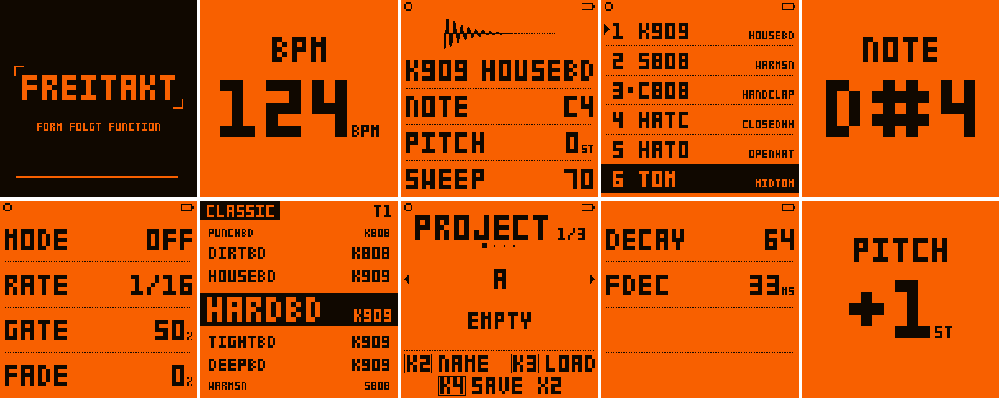

# FREITAKT

**FREITAKT** is alternative firmware for the **M-VAVE FM-1** pocket synth, with a workflow in the style of Elektron Model:Cycles: free polymeter and polyrhythm, parameter and machine locks, per-track Arp/Retrig and a minimal orange UI.

> FREITAKT is a fork of **[Hortator](https://github.com/DeadActive/hortator)** by DEADACTIVE,
> which is built on **[Felucca](https://github.com/hugelton/Felucca)** by Leo Kuroshita (Hügelton Instruments).
> The sound engine, the loader, the update path and the recovery tools are theirs; FREITAKT reworks the
> sequencer and the interface. All credit for the base goes to the original authors.
> The original Hortator README is kept in [docs/HORTATOR_README.md](docs/HORTATOR_README.md).

## What is different from Hortator

| | Hortator | FREITAKT |
|---|---|---|
| Tracks | 8 | 6 |
| Machines | 45 | same + **CHORD** (4-voice chords, one chord at a time) |
| Grids, RESON, SLICER, sample LAYER, Song mode, USB Audio 10 ch | yes | removed |
| LFOs per track | 2 | 1 |
| Polymeter | per-track length | + **FIT** divisions (5:4, 7:8 …) and **Master Length** (up to 1024 steps) |
| Parameter Lock | yes | yes, on any screen with SEL unlit |
| Machine Lock | no | **yes** (hold a step and turn MODEL) |
| Step note | only from keys | **NOTE** knob with names (C#4) + separate **PITCH** |
| Note length | only ACID's TIE steps | **NLEN** (Model:Cycles' LEN): 1…64 steps or INF, per track and per step lock, ACID / SAMPL (SUS) / CHORD; live recording keeps the held length |
| Arp / Retrig | no | **OFF / RTRG / ARP1 / ARP2** per track and step, live on the keys |
| Patterns | 16 rows | 4 patterns × 8 variations, Elektron-style chain (A1 B3 A2) |
| Copy / paste | TOOLS screen | button combos (track, pattern, step range) |
| Step LEDs | partial | Model:Cycles style: trigs, blinking locks, running playhead |
| UI | many pages, graphs | big lists, knob popup, carousels, ORANGE theme, boot splash |
| MIDI | in, clock, learn | + **MIDI OUT** of the sequencer, **MIDI keyboard** mode, **.mid export** in the web editor |

FREITAKT cannot read projects saved by the 8-track Hortator (different format).

## Install

1. Charge the FM-1 and use a data USB cable.
2. Download the latest release (`FREITAKT-installer.html`, the `.fwsc` package and the manual).
3. Open `FREITAKT-installer.html` in Chrome or Edge, connect the FM-1, click **Install**, allow MIDI access.
   Do not unplug the cable until it says Done.

**Going back:** hold **SEQ** while powering on → SAFE START → install the official firmware with
M-VAVE's updater (M-UPGRADE, firmware V15) from <https://www.m-vave.com/download>.
Full recovery steps (also for a crashed device): [docs/RECOVERY.md](docs/RECOVERY.md).

## Manual

The user manual (English and Russian, with screenshots) is attached to every release.
To build it from source: `sh tests/run_tests.sh` (makes the screenshots), then
`python3 tools/make_manual_html.py --lang en` → `build/FREITAKT_manual_EN.html`.
The chapter sources are in [docs/manual](docs/manual).

## Build

See [BUILDING.md](BUILDING.md) (JieLi toolchain, `./build.sh`, host tests in `tests/`).

## Disclaimer

This is unofficial firmware. It is not made or supported by M-VAVE, DEADACTIVE or Hügelton Instruments.
You install it at your own risk; the software comes with **no warranty** (see GPL-3.0, sections 15–16).

## License

Code: **GPL-3.0-only**, see [LICENSE](LICENSE) and [LICENSING.md](LICENSING.md).
Copyright (C) 2026 Leo Kuroshita (@kurogedelic), Hügelton Instruments; Hortator changes (C) 2026 DEADACTIVE;
FREITAKT changes (C) 2026 StripedBear. Asset and third-party terms: [LICENSING.md](LICENSING.md), [LICENSES/](LICENSES).
